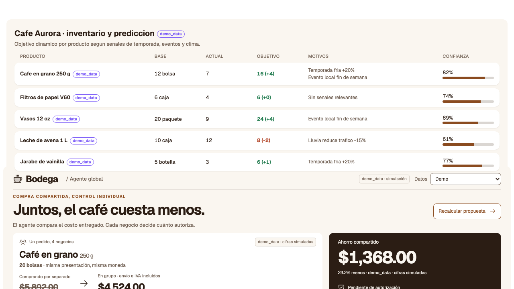
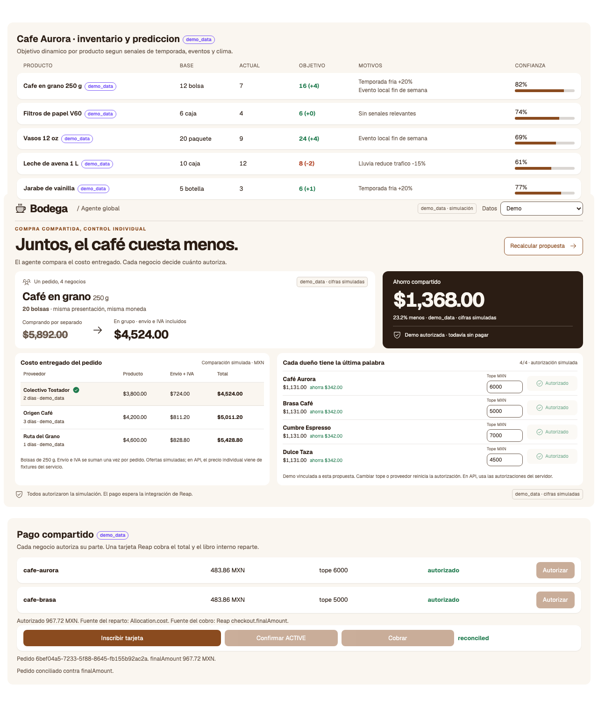
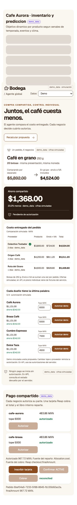

# Bodega

Stock objetivo dinámico por producto para negocios pequeños, y compras en grupo a través de un agente global.

> Hecho para el **Reap x AIBM Agentic Buildathon** (Reap x AI Builders México, 2026-10-09). Equipo Axolutions.
> Todos los datos de negocios, historiales de ventas y cifras de ahorro son **simulados** y llevan la etiqueta `demo_data: true`.
> Reap se usa **solo en su sandbox**: sin dinero real y sin tarjetas reales.

## Qué hace

Los negocios pequeños sin contrato con distribuidores mantienen un stock fijo, así que pierden ventas o inmovilizan capital.
Bodega ataca ambos lados:

1. **Agente local (uno por negocio).** Calcula un stock objetivo dinámico por producto a partir del historial de ventas,
   la temporada y los eventos cercanos, y explica por qué (`reasons[]`, `confidence`).
2. **Agente global.** Agrupa las faltas de varios negocios, compara proveedores por costo total entregado
   y reparte el ahorro para que cada negocio pague menos que comprando solo.
3. **Control.** Cada dueño autoriza su parte dentro de su tope de presupuesto. El agente nunca ve datos de tarjeta
   y se detiene a pedir aprobación si la cotización vence o el monto no coincide con lo autorizado.

El LLM nunca produce los números clave: solo convierte eventos y clima en señales validadas por esquema y redacta
explicaciones. Los objetivos, el ahorro y el reparto son código determinista y probado.

## Correr la demo (sin claves ni red)

Requisitos: [uv](https://docs.astral.sh/uv/) y Node.js.

```bash
cp .env.example .env            # DEMO_MODE es true por defecto; no se necesitan secretos
uv sync
npm --prefix web ci
npm --prefix web run build
uv run uvicorn app.main:app --port 8000
```

Abre <http://localhost:8000>. FastAPI sirve el frontend compilado y la API desde un solo proceso.

Con `DEMO_MODE=true` nada llama a Reap ni a un LLM: se usan las respuestas grabadas de `app/fixtures/`.
El estado de la demo vive en memoria: reinicia el servidor para repetirla desde cero.

### Desarrollo

```bash
uv run uvicorn app.main:app --reload --port 8000
npm --prefix web run dev        # http://localhost:5173, /api se redirige a FastAPI
```

Dentro de un worktree de UAK los puertos son `$UAK_PORT` (API) y `$UAK_PORT+1` (web).

## Configuración

Se lee de `.env` (ignorado por git). Nunca subas claves. Ver `.env.example`.

| Variable | Para qué sirve |
|---|---|
| `DEMO_MODE` | `true` (por defecto): fixtures grabados, sin red |
| `REAP_API_KEY` | Llave del sandbox de Reap; solo con `DEMO_MODE=false` |
| `REAP_BASE_URL` | Por defecto `https://sandbox.api.reap.global` |
| `REAP_VERSION` | Encabezado `Reap-Version`; el cliente usa `2025-02-14` si falta |
| `REAP_RETURN_URL` | URL HTTPS de retorno que exige el checkout de Reap |
| `ANTHROPIC_API_KEY` | Solo para extraer señales con el LLM en vivo |

El ID del modelo está fijado en un solo lugar: `app/config.py`.

## El flujo de 6 pasos

| # | Paso | Endpoint | Estado |
|---|---|---|---|
| 1 | Elegir un negocio y ver su stock base vs actual | (sin endpoint todavía) | Pantalla con datos de ejemplo, no conectada a la API |
| 2 | Predecir stock: objetivo dinámico, motivos y confianza | `POST /api/businesses/{id}/forecast` | Implementado (sin estado: recibe los productos en la petición) |
| 3 | Detectar faltas en los 4 negocios y publicarlas | herramienta MCP `publicar_faltas` | Implementado por MCP; sin endpoint HTTP |
| 4 | Agente global: comparación de proveedores y ahorro por negocio | `POST /api/global/proposals` | Implementado, con pantalla |
| 5 | Cada dueño autoriza su parte; checkout en sandbox | `/api/payments/ledgers`, `/authorizations`, `/enrollments`, `/checkouts` | Implementado en DEMO_MODE, con pantalla (termina en `reconciled`) |
| 6 | La cotización vence o se agota el stock: recalcular o detenerse | (dentro de `/api/payments/checkouts`) | Se detiene si la orden vence o el monto no coincide; sin recalculo automático |

Las señales (`GET /api/signals`, `POST /api/signals/extract`) alimentan el paso 2.
El servidor MCP (`python -m app.mcp`) expone `publicar_faltas`, `consultar_ofertas` y `proponer_compra`
entre el agente local y el global; ver `app/mcp/README.md`.

**Limitaciones conocidas.** Las pantallas del negocio y del agente global no comparten datos: la del negocio usa
cifras de ejemplo y las cifras del pago compartido (2 negocios) no coinciden con las de la propuesta del agente
global (4 negocios). Es una demo, no un flujo continuo único. La fuente de verdad del estado es `uak status`.

## Integración con Reap

La búsqueda, la cotización y el checkout usan el sandbox del Agentic API de Reap (`app/integrations/reap/`).
Sin llave, el sandbox responde `401 INVALID_AUTH_HEADER`; esas respuestas están grabadas en `app/fixtures/reap/`
y se reproducen en `DEMO_MODE`. **Todavía no se ha observado un checkout completado** en el sandbox real.
Detalles en `docs/REAP-NOTES.md`.

El precio por volumen no está verificado en Reap, así que las escalas de precio de la demo son simuladas y llevan `demo_data`.

## Pruebas

```bash
uv run pytest -q
bash .uak/bin/smoke             # ruff + pytest + lint web + build web
```

Prueba E2E del flujo en el navegador (movimiento reducido, con el servidor recién reiniciado):

```bash
BASE_URL=http://localhost:8000 uv run --with playwright python e2e/demo_flow.py
```

## Capturas

Tomadas de la app corriendo en `DEMO_MODE` (todas las cifras son simuladas, `demo_data: true`).
`e2e/demo_flow.py` las regenera en `e2e/screens/`.

| Inventario y predicción del negocio (1280x720) | Agente global y pago compartido (1280x720) | Móvil (390x844) |
|---|---|---|
|  |  |  |

## Estructura

```
app/            FastAPI: config, routers (autodescubiertos), servicios, esquemas, fixtures, integrations/reap, mcp
web/            React + Vite; las features de web/src/features/* se descubren solas
docs/           Idea, notas de Reap, guion de la demo
e2e/            Prueba E2E del flujo de la demo y sus capturas
```

## Alcance

Fuera de alcance: negocios con contratos recurrentes con distribuidores, logística propia, cobros recurrentes
(los mandates no están disponibles), compras reales, perecederos complejos, viajes y categorías restringidas.
